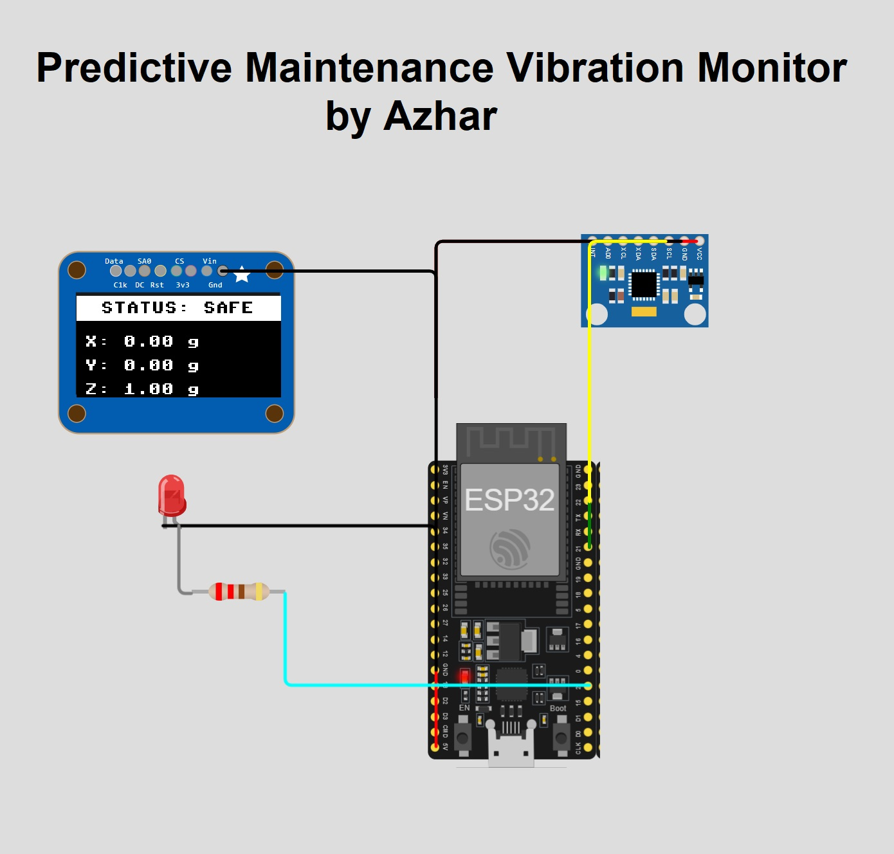
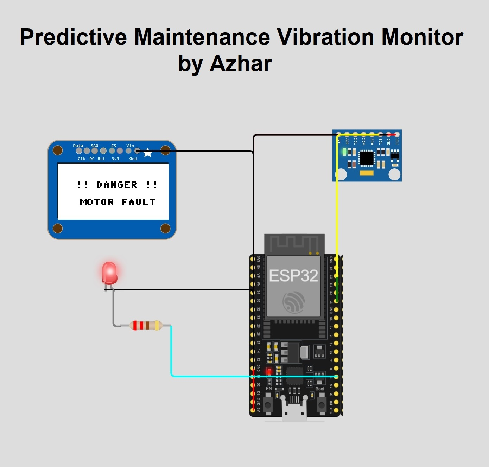

# ESP32 Predictive Maintenance Vibration Monitor (MicroPython / MQTT) ☁️

## 📖 Overview
This project is a comprehensive Industrial Internet of Things (IIoT) edge gateway engineered to predict machine failures before they occur. Powered by an **ESP32** running **MicroPython**, the system utilizes an MPU6050 6-axis accelerometer to continuously monitor the physical vibration signatures (X, Y, and Z-axis g-force) of factory machinery. 

Unlike basic sensors that blindly stream data, this device features true **"Edge Computing."** It evaluates physical danger thresholds locally to trigger an instant, high-contrast OLED warning for technicians on the factory floor. Simultaneously, it serializes the telemetry into a structured JSON payload and securely publishes it to an enterprise cloud broker via the **MQTT** protocol over Wi-Fi. It also listens for incoming cloud commands to allow remote emergency shutdowns.

## 🎯 Projects For...
- **Embedded Systems Candidates:** An excellent portfolio piece demonstrating advanced hardware multiplexing (sharing an I2C bus across multiple devices), bare-metal memory register reading, and transitioning from C++ to high-level MicroPython firmware development.
- **Industrial IoT Engineers:** A highly practical demonstration of industry-standard networking (MQTT) and edge-to-cloud data ingestion required for automated factory environments and SCADA systems.
- **Automation Architects:** A hands-on implementation of Industry 4.0 concepts, showcasing remote telemetry, bidirectional cloud control, and the foundational algorithms of predictive maintenance.

## 🛠️ Tech Stack & Components
- **Microcontroller:** ESP32 (30-pin DevKitC v4)
- **Firmware Language:** MicroPython (v1.20+)
- **Simulation Environment:** Wokwi Simulator
- **Network Protocol:** Wi-Fi (802.11) & MQTT (Message Queuing Telemetry Transport)
- **Required Libraries:**
  - `machine` (Pin, SoftI2C - Built-in)
  - `network`, `ujson`, `time` (Built-in)
  - `umqtt.simple` (For MQTT client publish/subscribe connectivity)
  - `ssd1306` (Official MicroPython OLED display driver)
- **Hardware Components:**
  - 1x MPU6050 Accelerometer & Gyroscope Module
  - 1x SSD1306 128x64 I2C OLED Display
  - 1x Red LED (Local visual alarm indicator)
  - 1x 220Ω Resistor (Current limiting for the LED)
  - Jumper wires & Breadboard (for physical circuit construction)

## ✨ Features
- **Shared I2C Bus Multiplexing:** Efficiently drives both the MPU6050 sensor and the SSD1306 OLED display using a single set of I2C pins (SDA 21, SCL 22), saving valuable GPIO real estate on the microcontroller.
- **Bare-Metal Sensor Math (No External Libraries):** Reads specific memory registers directly from the MPU6050 using bitwise operations to extract raw high/low bytes. It mathematically converts these raw 16-bit values into precise standard gravity (g-force) metrics, bypassing the need for bulky external sensor libraries.
- **Edge Computing Thresholds:** Evaluates vibration data locally in real-time. If any axis exceeds the safe threshold (1.50g), the edge device triggers a fault. This prevents spamming the cloud server with useless "safe" data and ensures zero-latency visual alerts for local technicians.
- **High-Contrast Industrial UI:** Utilizes OLED screen pixel inversion (`oled.fill(1)`) to create a massive, flashing solid-white screen during a "DANGER" state. This mimics real industrial Programmable Logic Controller (PLC) visual alarms that must be visible from across a factory floor.
- **Bidirectional MQTT Pipeline:** Publishes JSON-formatted vibration data and system status every 2 seconds to the cloud. Concurrently, the system subscribes to remote command topics, allowing an enterprise dashboard to trigger a local physical alarm override.

## 🔌 Hardware Configuration (Pinout)

### I2C Shared Bus (MPU6050 & OLED)
| Component Pin | ESP32 Pin | Description |
| ----- | ----- | ----- |
| MPU6050 GND | GND.1 | Shared System Ground |
| MPU6050 VCC | 5V / VIN | Sensor Power (Regulated to 3.3V internally on the module) |
| OLED GND | GND.1 | Shared System Ground |
| OLED VCC | 3V3 | Display Power (Strictly 3.3V) |
| SDA (Both) | Pin 21 | I2C Serial Data line (connects both sensor and display) |
| SCL (Both) | Pin 22 | I2C Serial Clock line (connects both sensor and display) |

### Local Alarm Output
| Component Pin | ESP32 Pin | Description |
| ----- | ----- | ----- |
| Red LED Anode (+) | Pin 2 | Output signal to trigger the visual hardware alarm |
| Red LED Cathode (-)| GND.1 | Routed through a 220Ω resistor to ground |

### Step-by-Step Wiring Instructions:
1. Connect the **GND** pins of the ESP32, the MPU6050, and the OLED to the common ground rail of your breadboard. Connect the LED's cathode to ground via the 220Ω resistor.
2. Connect the **VCC** of the MPU6050 to the 5V (VIN) pin of the ESP32.
3. Connect the **VCC** of the OLED specifically to the 3V3 pin of the ESP32 (applying 5V may damage the screen).
4. Run a wire from ESP32 **Pin 21** to the **SDA** pin on the MPU6050. Run another wire from that same MPU6050 SDA pin to the **SDA** pin on the OLED.
5. Run a wire from ESP32 **Pin 22** to the **SCL** pin on the MPU6050. Run another wire from that same MPU6050 SCL pin to the **SCL** pin on the OLED.
6. Connect the LED Anode to ESP32 **Pin 2**.

## 🚀 End-to-End Setup Guide

### Option A: Running in Wokwi Simulator (Web-based)
1. Navigate to Wokwi.com and create a new **MicroPython (ESP32)** project.
2. Open the `diagram.json` tab, delete the default text, and paste this project's complete JSON layout configuration.
3. **Install the OLED Driver:** Click the **"+" (New File)** icon in the top left. Name it exactly `ssd1306.py`. Paste the official MicroPython SSD1306 driver code into this file (this is required because Wokwi does not pre-install it).
4. Open the `main.py` tab and paste the main MicroPython firmware code.
5. Click the **▶ Play** button. The ESP32 will boot, connect to the simulated `Wokwi-GUEST` Wi-Fi, initialize the OLED UI, and connect to the HiveMQ public broker.
6. **Testing the Edge Logic:** Click on the MPU6050 sensor while the simulation is running. A slider menu will appear. Drag the X, Y, or Z acceleration slider past `1.5 g`. You will instantly see the LED turn on and the OLED screen invert into a flashing danger mode.
7. **Testing the Cloud MQTT:** Open a new browser tab and go to a free MQTT Websocket Client (like `http://www.hivemq.com/demos/websocket-client/`). Connect to `broker.hivemq.com`. Under the "Add New Topic Subscription" section, enter `factory/machine1/vibration` and click Subscribe. You will see your ESP32's JSON data arriving live!

### Option B: Deploying to Physical Hardware
1. **Flash MicroPython Firmware:** 
   - Download the latest ESP32 `.bin` file from `micropython.org/download/ESP32/`.
   - Open your command prompt/terminal and use esptool to erase the flash: `esptool.py --chip esp32 --port COM3 erase_flash` (replace COM3 with your actual port).
   - Flash the firmware: `esptool.py --chip esp32 --port COM3 write_flash -z 0x1000 esp32-YYYYMMDD-v1.XX.bin`.
2. **Setup Thonny IDE:** Download and install Thonny. Go to `Tools > Options > Interpreter` and select "MicroPython (ESP32)" and your correct COM port.
3. **Upload Required Libraries:**
   - In Thonny, go to `View > Files` to see your computer's files and the MicroPython device files.
   - You must download `ssd1306.py` and `umqtt/simple.py` from the official MicroPython GitHub repositories.
   - Right-click these files on your computer panel and select **"Upload to /"** to save them to the ESP32's internal memory.
4. **Configure Credentials:** Paste the `main.py` code into Thonny. Locate the `# --- Cloud & Network Setup ---` section at the top of the script. Change `WIFI_SSID` and `WIFI_PASS` to your actual home/office Wi-Fi credentials.
5. **Execute:** Click the Green Play button in Thonny to run the script on the physical hardware.

## 🧠 Code Explanation
The firmware is architected into distinct sequential blocks, managing networking, bare-metal hardware interfacing, edge logic, and telemetry publishing:

1. **Hardware & Network Initialization (`SoftI2C` & `network.WLAN`):** 
   The ESP32 does not restrict I2C to specific hardware pins, so we utilize `SoftI2C` to manually assign Pins 21 and 22. We pass this single `i2c` object to initialize the `ssd1306.SSD1306_I2C` display. The system then enters a `while not wifi.isconnected():` loop, blocking further execution until the `network.WLAN` station interface successfully binds to the Wi-Fi router and obtains an IP address.

2. **Bare-Metal Sensor Math (`read_raw_data`):** 
   Instead of using a heavy library, we talk to the MPU6050 directly. 
   - First, we send `0x00` to the power management register (`0x6B`) to wake the sensor from sleep mode. 
   - To read the X-axis, we request 2 bytes starting at register `0x3B` (`ACCEL_XOUT_H`).
   - The sensor returns a 16-bit integer split into a High byte and a Low byte. We reconstruct it using bitwise shifting: `val = (high << 8) | low`.
   - Because physical acceleration can be negative (moving backward), we must handle Two's Complement math: `if val > 32768: val = val - 65536`.
   - Finally, we divide the raw integer by `16384.0` (the default Least Significant Bit sensitivity for a +/- 2g range) to convert the number into standard gravity metrics (e.g., `0.98 g`).

3. **Edge Logic & High-Contrast UI (The State Machine):** 
   Inside the main loop, we establish a `DANGER_THRESHOLD = 1.50`. We use the absolute value `abs(gx)` to check if the vibration exceeds 1.5g in *either* a positive or negative direction. 
   - **Safe State:** The OLED clears the screen (`fill(0)`), draws a solid white header banner using `fill_rect`, and prints the live X/Y/Z data in standard black/white text.
   - **Danger State:** A `flash_state` boolean is toggled using `not flash_state`. On alternating loops, the code calls `oled.fill(1)` (turning every pixel on the screen white) and prints black text on top of it. This creates a highly visible, flashing emergency beacon. Pin 2 is also driven HIGH to turn on the physical red LED.

4. **Cloud Telemetry (JSON Serialization & MQTT Timers):** 
   We must never use `time.sleep()` in the main loop, as this would freeze the UI and cause the MQTT connection to drop. Instead, we use a non-blocking timer: `if time.time() - last_msg_time > 2.0:`. This ensures we only publish data to the cloud every 2 seconds, while the OLED updates instantly. The X, Y, Z data and the system state ("SAFE" or "DANGER") are packed into a Python dictionary, converted into a JSON string using `ujson.dumps`, and pushed to the HiveMQ broker using `client.publish()`. We simultaneously call `client.check_msg()` at the start of every loop to listen for manual remote overrides coming from the cloud.

## 👤 Author
**Md. Azharul Islam**
- GitHub: [@mdazharulislamnk](https://github.com/mdazharulislamnk)
- LinkedIn: [mdazharulislam](https://www.linkedin.com/in/mdazharulislam/)

*Built to demonstrate proficiency in Embedded Systems, Cloud IIoT integration, and MicroPython firmware development.*